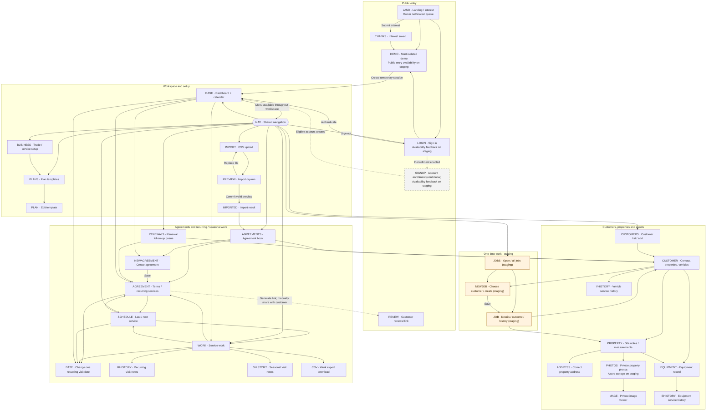

# Sideyard product map

This is Sideyard’s canonical product documentation: the pages people can use,
how they move between them, what each page does, and how to configure a client.
Read this before onboarding a business or planning a product change. The
[execution plan](SIDEYARD-EXECUTION-PLAN.md) describes future work;
[delivery status](SIDEYARD-DELIVERY-STATUS.md) holds deployment evidence.
The [Azure execution plan](SIDEYARD-AZURE-PLAN.md) tracks the infrastructure
migration. Azure photo integration is verified on staging; the main application
database still uses PostgreSQL. Production cloud resources are provisioned.
See [delivery status](SIDEYARD-DELIVERY-STATUS.md#azure-migration--implementation-started-september-9-2026)
for the distinction between provisioned resources and deployed app behavior.

## Availability snapshot

Reviewed September 9, 2026 against staging release `8346ace` and the recorded
release verification. These are verified release states, not a live deployment monitor.

| Label | Meaning |
| --- | --- |
| **Live** | Available in production at [getsideyard.com](https://getsideyard.com), source `ae6f16a`, and on staging. The legacy ClubDue hostname remains supported. |
| **Staging** | Available only on [staging](https://clubdue-staging.michelindigitalmedia.com), release `8346ace`: standalone jobs/site surveys, the single-line work-status badge fix, and configured private Azure photo storage. |
| **Conditional** | Implemented but requires explicit deployment configuration; not a promise of availability to clients. |

Unless marked otherwise, catalog nodes are **Live**. “Signed in” means a user
of the current shop; “Owner” means the handler additionally requires the owner
role. Older customer, agreement, import and work screens allow signed-in staff.
Property records, private histories, vehicle management, business setup and jobs
are owner-only. Fine-grained crew permissions and a team-management UI do not
exist yet. Private records stay within their shop; the public renewal page is a
separate, limited token-based view.

## Directed page graph

Arrows point from an entry page to a destination through a link, successful form
submission, or the labeled handoff. Solid arrows show principal navigation;
dashed arrows mark conditional or cross-user handoffs. Back links and repeated
menu links are omitted for readability. **NAV** represents the shared menu on
every signed-in page, not an extra screen. Filters, inline forms and the calendar
are documented inside their page nodes. Import has three distinct screen states.
Orange nodes explicitly marked “staging” are not yet production features.

## Page catalog

Node IDs match the graph. Source links identify the template or handler that
implements the features. An ID in a URL means an existing record in the current
shop; it is not a client-facing identifier to invent during onboarding.

### LAND — Landing and interest registration

**Route:** `GET /`; form `POST /interest`. **Access:** Public.
[Source](../internal/app/templates/landing.html) · [Notification behavior](SIDEYARD-NOTIFICATIONS.md).

- Introduces Sideyard, links to sign-in and the enabled demo, and collects early-access interest.
- Required name and email; optional business, trade and free-text needs. Trade accepts free text; marketing suggestions are separate from business presets.
- Saves interest and queues an owner email through Resend. Production notification delivery is configured; duplicate email submissions do not create repeated alerts. Failed delivery retries without losing the signup.
- **Staging worker; delivery requires Resend configuration:** successful saves wake delivery after commit; empty queues stop polling. Startup and daily maintenance reconcile durable work, while known pending failures keep their retry timers. A lost process handoff can delay recovery until reconciliation; prolonged outages can produce a duplicate beyond the provider's deduplication window. This does not enable SQL Server for the application.
- Submission leads to THANKS. It does not create a shop or login. There is no in-app lead-management page yet.

### THANKS — Interest confirmation

**Route:** `GET /interest/thanks`. **Access:** Public.
[Source](../internal/app/templates/interest_thanks.html).

Confirms saved interest, explains future early-access contact, and links back to
the landing page or into the enabled demo. This is not an account dashboard.

### LOGIN — Sign in

**Route:** `GET/POST /login`; sign-out action `POST /logout`. **Access:** Public.
[Source](../internal/app/templates/login.html).

Email/password authentication, validation and failed-attempt feedback; successful
login opens DASH. Offers the demo when enabled and enrollment only when open.
There is no self-service password-reset screen; use [owner recovery](OWNER-PROVISIONING.md).

**Staging:** GET renders without querying an old session;
it does not automatically redirect a signed-in visitor. Sign-in/database failures
return temporary-unavailability feedback with the email preserved, without
counting a bad password or clearing an existing session. Missing/expired sessions
still lead to sign-in; protected requests fail closed during an outage.

### DEMO — Isolated prospect demo

**Route:** `GET /demo` → `POST /demo/session`. **Access:** Public when enabled;
enabled on the recorded production and staging releases.
[Source](../internal/app/templates/demo_entry.html) · [Handler](../internal/app/demo_handlers.go).

**Staging:** the entry GET is database-free; its
CSRF-protected POST recognizes an existing owner session and returns to DASH.
A failed session lookup cannot replace that owner session with a new demo.

Starts an isolated fictional landscaping shop with 30 customers, without shared
credentials. Automatic entry has a manual button fallback. Sessions expire after
four hours; mutations and imports are bounded, and photo upload/delete is disabled.
Use fictional or redacted inputs only. It is a temporary owner walkthrough, not
a persistent client account; backups may retain demo data for up to 30 days.

### SIGNUP — Conditional account enrollment

**Route:** `GET/POST /signup`. **Access:** Public entry, restricted enrollment;
**Conditional**, closed in the documented deployed pilot configuration.
[Source](../internal/app/templates/signup.html) · [Configuration](../internal/app/config.go).

When explicitly enabled, collects shop name, email and password and opens the
new account. Deployment allowlists restrict eligibility. Closed deployments show
a closed-enrollment message. Provision real pilot owners through the operator
runbook instead of sending them here or assuming interest registration enrolls them.

**Staging:** the enrollment GET is database-free. Database
failures preserve the entered shop name/email, return 503, and do not consume
bad-credential attempts. Only validation errors are displayed as submitted-input
feedback; database details stay internal. Passwords are never redisplayed.

### NAV — Shared workspace navigation

**Route:** Shared layout, no standalone URL. **Access:** Signed in.
[Source](../internal/app/templates/layout.html).

Links to dashboard, agreements, renewals, service work, schedule, customers,
import and plan templates. Owners also see business setup and, on staging, jobs.
Includes sign-out, active-page indication and the public-demo notice. Every
signed-in catalog page includes this menu even where graph edges are omitted.
There is no shop switcher or team administration screen.

### DASH — Dashboard and recurring calendar

**Route:** `GET /dashboard`. **Access:** Signed in.
[Dashboard](../internal/app/templates/dashboard.html) · [Calendar](../internal/app/templates/calendar.html).

- Active agreements, lapsed month-to-date, active-plan MRR, renewals due this month/next 90 days and overdue services. MRR is derived from plan values, not collected payments.
- Month calendar with previous/next/today controls, day selection, daily agenda/pagination, overdue indication and moved-date context.
- Open an agreement, change a recurring visit’s date or open service work; quick links to the main work lists and new agreement.
- Calendar contains pending recurring occurrences only. Seasonal work and staging standalone jobs are not included. Generation has an approximately 90-day forward horizon; browsing later months does not generate more work.

### BUSINESS — Business setup

**Route:** `GET/POST /business`. **Access:** Owner.
[Source](../internal/app/templates/business_settings.html).

Choose primary/additional trades: auto detailing, house washing, landscaping,
HVAC, plumbing, electrical, or General. Preview suggested services, choose which
to apply, then edit names/descriptions or disable them. Reapplying preserves
custom edits; conflicting saves are rejected. Links to plan templates.

Starter services are unpriced preparation records. They do not automatically
create plans, jobs, schedules, pricing, checklists or configurable fields.

### CUSTOMERS — Customer list and creation

**Route:** `GET/POST /customers`. **Access:** Signed in.
[Source](../internal/app/templates/customers.html).

List customer contacts, add a customer with name/email/phone, and open CUSTOMER.
This is the starting point for manual client-data entry; bulk entry uses IMPORT.

### CUSTOMER — Customer, properties and vehicles

**Route:** `GET/POST /customers/{id}`. **Access:** Signed in; vehicle section Owner.
[Source](../internal/app/templates/customer_form.html) · [Handler](../internal/app/customer_handlers.go).

- Edit contact details. Delete via `POST /customers/{id}/delete` when no agreements exist; staging also blocks deletion when jobs exist.
- Add/list multiple service addresses, including unit/suite, via `POST /customers/{id}/properties`. Add/list equipment per property via `POST /properties/{id}/equipment`.
- Owners open property details, equipment editing and private histories. Vehicle creation/editing is inline via `POST /customers/{id}/vehicles`: multiple vehicles, name, make/model/year, optional identifier and internal standing notes. Vehicles do not require a property.
- **Staging:** create a job/site survey already associated with this customer.
- No combined customer-wide authored activity timeline yet. Property/asset/visit notes have their own pages.

### PROPERTY — Property details, site notes and measurements

**Route:** `GET/POST /properties/{id}`. **Access:** Owner.
[Source](../internal/app/templates/property_record.html).

- Edit standing site/access information, separately from append-only dated site notes with recording author/time. Corrections are new entries; site-note event dates are date-only.
- Record measurements by named zone: turf, beds, driveway, walkway, patio, roof, building footprint, floor, exterior wall, perimeter, other area or other length.
- Store value, matching area/length unit, source, measured date and estimated flag. Measurement history preserves prior entries; unknown measurements remain absent. Notes/measurements show the latest 100 entries while retaining older records.
- Open address correction, private photos or equipment; return to the customer to add equipment.
- Launch Google or Apple Maps directions using the address. No route optimization, aerial measurement or Deep Lawn connection.

### ADDRESS — Correct property address

**Route:** `GET/POST /properties/{id}/address`. **Access:** Owner.
[Source](../internal/app/templates/property_address.html).

Correct street, unit, city, state and postal code while preserving the property
and attached records. Detects stale saves, including intervening import changes.
Returns to the property. Existing views use the current address; historical
contract-address snapshots are not implemented.

### PHOTOS — Private property photos

**Route:** `GET/POST /properties/{id}/photos`; delete `POST /property-photos/{id}/delete`.
**Access:** Owner; demo upload/delete disabled.
[Source](../internal/app/templates/property_photos.html) · [Limits and retention](SIDEYARD-PHOTOS-DELIVERY.md).

Upload/view/delete private JPEG/PNG images with captions and before/after/damage/
access/general categories. Images are normalized and metadata removed; HEIC
requires conversion. Limits: 5 MiB input, 4 MiB normalized image, 100 active photos
and 50 MiB per shop. Deletion removes live image content; older encrypted backups
may retain it for up to 30 days. Photos belong to properties, not individual jobs
or visits. Open IMAGE for a full image or return to PROPERTY.

**Azure integration — Staging, requires deployment configuration:** configuration
can store normalized images in private, versioned Blob storage. New uploads count
toward quota while awaiting confirmation and appear only after it succeeds.
Retries reuse the same object; failed migration of an existing photo preserves
its database copy and visibility. Operators use `sync-photos` to resume/backfill.
Database recovery copies are retained during rollout. Azure object version
cleanup is not enabled; seven-day recovery is not a promise of physical deletion
at seven days. [Storage implementation](../internal/app/azure_photos.go) ·
[Operator setup](../infra/azure/README.md).

### IMAGE — Private image viewer

**Route:** `GET /property-photos/{id}`. **Access:** Owner of the image’s shop.
[Source](../internal/app/property_photo_handlers.go).

Authenticated image response opened from PHOTOS. It has no management form and
is not a public sharing URL. Browser back returns to the photo collection.
With Azure configured (verified on staging), authorization happens before the
exact saved Blob version is fetched and its hash, size and MIME type verified.
Azure outages return a retryable error; disabling Azure explicitly enables the
retained database recovery copies. Storage keys and direct Blob URLs are never
sent to the browser. [Version client](../internal/photostore/azure.go).

### EQUIPMENT — Equipment record

**Route:** `GET/POST /equipment/{id}`. **Access:** Owner.
[Source](../internal/app/templates/equipment_record.html).

Edit kind, make/model, serial/reference, location at the property, installation
date, warranty end and current private details. Optional dates can remain unknown.
Preserves equipment identity and rejects stale saves. Links to the customer,
property and authored equipment history. Multiple units can belong to a property;
creation happens on CUSTOMER.

### VHISTORY — Vehicle service history

**Route:** `GET/POST /vehicles/{id}/history`. **Access:** Owner.
[Shared history UI](../internal/app/templates/asset_history.html) · [Handler](../internal/app/asset_history_handlers.go).

Read/add internal service-event notes for one vehicle and return to CUSTOMER.
Required event date, optional local time, editable IANA timezone, recording author
and timestamp. Unknown time stays blank; ambiguous clock-change times require a
choice. Corrections append; retries do not duplicate notes. Shows latest 100,
retains older entries. These notes are excluded from public pages and work CSV.

### EHISTORY — Equipment service history

**Route:** `GET/POST /equipment/{id}/history`. **Access:** Owner.
[Shared history UI](../internal/app/templates/asset_history.html) · [Handler](../internal/app/asset_history_handlers.go).

Read/add authored event notes for one equipment unit with the same date, optional
time/timezone, correction, retry and retention behavior as VHISTORY. Return to
EQUIPMENT. This timeline is separate from editable current equipment details.

### PLANS — Plan template list and creation

**Route:** `GET/POST /plan-templates`. **Access:** Signed in.
[Source](../internal/app/templates/plan_templates.html).

List and create reusable plans: name, description, price in cents, term in months
and included services per year (new-form default zero). Open PLAN to edit. These
are maintenance-plan terms, not the unpriced BUSINESS starter services or a quote/
invoice builder. Create matching templates before an import uses `plan_name`.

### PLAN — Edit plan template

**Route:** `GET/POST /plan-templates/{id}`. **Access:** Signed in.
[Source](../internal/app/templates/plan_template_form.html).

Edit name, description, price, term and included-service count with validation.
Changes affect the reusable template going forward; existing agreements retain
captured terms. Return to PLANS.

### AGREEMENTS — Agreement book

**Route:** `GET /agreements`. **Access:** Signed in.
[Source](../internal/app/templates/agreements.html).

List agreements with active/all and renewal-window filters, customer/property,
plan, anniversary, included services, price and status. Open the customer or an
agreement; create a new agreement. This tracks commitments, not invoices or payments.

### NEWAGREEMENT — Create agreement

**Route:** `GET /agreements/new`; save `POST /agreements`. **Access:** Signed in.
[Source](../internal/app/templates/agreement_form.html).

Choose customer, optional property, optional template or custom terms, status,
anniversary, included-service entitlement/usage, price and notes. Saves an
agreement and opens AGREEMENT. Customers and any desired reusable template must
already exist. No customer quote acceptance or payment collection occurs here.

### AGREEMENT — Agreement terms and recurring services

**Route:** `GET/POST /agreements/{id}`. **Access:** Signed in.
[Source](../internal/app/templates/agreement_form.html).

- Edit agreement fields, status, price and entitlement/usage. Captured plan terms are preserved independently of later template edits.
- Add named recurring work with daily/weekly/monthly cadence, interval, start/end dates and optional entitlement consumption via `POST /agreements/{id}/service-schedules`.
- Review last/next service; pause/resume via `POST /service-schedules/{id}`, move the next occurrence or open SCHEDULE. Pausing or importing changed service terms resets pending future visits, including manual moves.
- Generate a 30-day customer renewal link via `POST /agreements/{id}/renewal-link`, then copy/share it manually. No automatic email/SMS is sent by this action.
- Agreement pricing does not implement deposits, installments, per-treatment invoices or live payment collection.

### RENEWALS — Renewal follow-up queue

**Route:** `GET/POST /renewals`. **Access:** Signed in.
[Source](../internal/app/templates/renewals.html).

Work 90/60/30/14/7-day renewal tasks with due/past-due state, anniversary,
customer contact and property. Open customer/agreement, launch phone/email links,
and record open/contacted/renewed/lost outcomes and notes. This is manual
follow-up tracking; it does not automatically contact customers or collect money.

### RENEW — Customer renewal view

**Route:** `GET/POST /renew/{token}`. **Access:** Holder of a valid renewal link;
no owner login required.
[Source](../internal/app/templates/renewal.html) · [Handler](../internal/app/renewal_handlers.go).

Shows the issuing business, customer, plan, renewal date and annual price.
Production directs the customer to contact the business. An explicitly enabled
staging/development test-payment stub can acknowledge a test without charging a
card or marking the agreement paid. There is no live checkout, saved payment
method or general customer portal.

### WORK — Service work

**Route:** `GET/POST /visits`. **Access:** Signed in; private visit notes Owner.
[Source](../internal/app/templates/visits.html).

- Due-only/all views with customer phone links, location, service name, date and status.
- Separate recurring and seasonal queues; select/clear rows and confirm bulk updates. Recurring work can complete/skip; seasonal work can be handed off/completed. Completion consumes configured entitlement where applicable.
- Recurring rows link to their agreement and individual date change. Both kinds link owners to their own visit notes. Open SCHEDULE or export the filtered work CSV.
- Handed-off work has no appointment time. Staging standalone jobs remain in JOBS. **Staging visual change:** status labels such as “Due today” remain on one line.

### SCHEDULE — Last and next recurring service

**Route:** `GET /schedule`. **Access:** Signed in.
[Source](../internal/app/templates/schedule.html) · [Scheduling rules](SCHEDULING.md).

See last recorded completion and next pending occurrence per recurring service,
ordered by next date, with cadence and overdue state. Open the agreement, change
the next visit date or open WORK to record completion/view history. Completion
dates indicate when completion was recorded. This is not a crew dispatch board;
seasonal windows and standalone jobs are not a combined appointment calendar.

### DATE — Change one recurring visit date

**Route:** `GET/POST /service-occurrences/{id}/date`. **Access:** Signed in.
[Source](../internal/app/scheduling_handlers.go).

Review original/current dates and move one pending occurrence within its service
bounds without shifting the rest of the cadence. Rejects conflicts and changes
to closed/skipped visits or paused/inactive service. Returns to the originating
calendar context or schedule. This sets a day, not an arrival-time window.

### RHISTORY — Recurring visit notes

**Route:** `GET/POST /service-occurrences/{id}/history`. **Access:** Owner.
[Source](../internal/app/asset_history_handlers.go) · [Visit behavior](SIDEYARD-VISIT-HISTORY-DELIVERY.md).

Read/add private authored event notes for one recurring occurrence, including
optional time/timezone and preserved corrections as on VHISTORY. Return to WORK.
Adding a note does not complete the visit, consume entitlement or trigger billing.
Latest 100 notes are shown; older notes retained. No attached visit photos yet.

### SHISTORY — Seasonal visit notes

**Route:** `GET/POST /visits/{id}/history`. **Access:** Owner.
[Source](../internal/app/asset_history_handlers.go) · [Visit behavior](SIDEYARD-VISIT-HISTORY-DELIVERY.md).

The same authored event-note features as RHISTORY, attached to a seasonal visit
instead of a recurring occurrence. Return to WORK. Notes remain separate from
handoff/completion and are excluded from work CSV and public renewal pages.

### CSV — Service-work export

**Route:** `GET /visits/export.csv`, optional `?filter=all`. **Access:** Signed in.
[Source](../internal/app/visits_handlers.go).

Downloads the due/all work selection with customer name, phone, address,
service type and the legacy work-note field. New private property/asset/visit
histories and photos are excluded. This is a download, not another editable page.

### IMPORT — CSV upload

**Route:** `GET /import`; upload `POST /import`. **Access:** Signed in.
[Source](../internal/app/templates/import.html) · [Handler](../internal/app/import_handlers.go).

Download a fictional sample, review supported columns and upload a CSV for a
mandatory dry-run. Required columns: `external_id`, `customer_name`,
`address_line1`, `city`, `state`, `postal_code`, `anniversary_date`. Optional contact,
plan/status/price and recurring-service cadence fields are supported. Existing
plan names must match templates. Reimports match external IDs to update records.
No direct Sheets OAuth, Deep Lawn or property-measurement import exists.

### PREVIEW — Import dry-run

**Route:** Rendered by `POST /import`. **Access:** Signed in.
[Source](../internal/app/templates/import.html) · [Handler](../internal/app/import_handlers.go).

Review new/updated customer, agreement and recurring-service counts, skipped rows
and line-specific errors before writing. Replace the file or commit a valid
preview. Demo previews have additional size/row limits, expire after 15 minutes
and commit only once. Failed validation does not mean records were imported.

### IMPORTED — Import result

**Route:** Rendered by commit `POST /import`. **Access:** Signed in.
[Source](../internal/app/templates/import.html).

Shows committed result counts and links to agreements or another import. Verify
the imported agreements and schedule before using the workspace with a client.

### JOBS — Standalone job list

**Route:** `GET /jobs`, optional `?filter=all`. **Access:** Owner. **Staging**.
[Source](../internal/app/templates/jobs.html) · [Delivery evidence](SIDEYARD-JOBS-DELIVERY.md).

Open/all list for one-time service jobs and site surveys, displaying customer,
optional property, planned day and status. Shows the first 100 matching jobs,
ordered by planned day with undated work afterward. Open a job or start NEWJOB.
These records do not require an annual agreement.

### NEWJOB — Choose customer and create job

**Route:** `GET /jobs/new`, then `?customer_id={id}`; save `POST /jobs`.
**Access:** Owner. **Staging**.
[Source](../internal/app/templates/jobs.html) · [Handler](../internal/app/jobs_handlers.go).

Choose an existing customer (or enter from CUSTOMER), then service job/site-survey
type, title, optional same-customer property, optional planned day and internal
details. An empty customer list links to customer creation. Repeated identical
submissions do not duplicate the job. Save opens JOB; no agreement or invoice is
created, and starter services are not automatically applied.

### JOB — Job details, outcome and history

**Route:** `GET/POST /jobs/{id}`. **Access:** Owner. **Staging**.
[Source](../internal/app/templates/jobs.html) · [Handler](../internal/app/jobs_handlers.go).

Edit an open job’s type/title/property/date/details with stale-save protection;
complete, cancel or explicitly reopen it. Closed jobs must reopen before editing.
Customer identity is fixed after creation. Authored change snapshots preserve
history (latest 100 displayed). Links to jobs, customer and associated property.
Planned days appear in JOBS only; appointment times, crews, quotes, payments,
job-specific event notes, equipment/vehicle associations and job photos remain future work.

## Client onboarding using this map

1. **Qualify the workflow.** Establish the trade(s), properties/assets, repeat versus one-time work, access needs and billing expectations. Use the table below and agree on gaps before loading real data. The current pilot targets an owner-operated workspace.
2. **Demonstrate with fictional data.** LAND → DEMO → DASH. Explain the four-hour limit. A demo or interest submission does not create a permanent workspace.
3. **Provision the real owner.** Follow [owner provisioning](OWNER-PROVISIONING.md) and the [controlled-pilot checklist](CONTROLLED-PILOT.md), then LOGIN. There is no client-provisioning UI. Keep credentials out of product docs.
4. **Configure services and plan terms.** NAV → BUSINESS: choose primary/additional trades, preview and customize starter names. Separately create PLANS if needed. Do not assume presets schedule or price work.
5. **Load customers and context.** CUSTOMERS → CUSTOMER → PROPERTY/EQUIPMENT/VHISTORY. Add site/access notes, sourced measurements and appropriate photos. Or IMPORT → PREVIEW → IMPORTED, then inspect the created records. Load only information needed for the agreed pilot.
6. **Set up the work.** For recurring commitments: AGREEMENTS → NEWAGREEMENT → AGREEMENT → SCHEDULE/DASH → WORK. For standalone service or a site survey: CUSTOMER → NEWJOB → JOB, **currently staging only**.
7. **Verify with the owner.** Check a customer/property, planned occurrence, safe date change, internal history entry and renewal follow-up. Keep payments in the client’s existing billing system; agree how Sideyard records relate to that system. See the [guided demo](demo-script.md) and [operations runbook](OPERATIONS-RUNBOOK.md).

| Client vertical | Useful live configuration/pages | Gaps to agree before onboarding |
| --- | --- | --- |
| Auto detailing | Detailing preset; CUSTOMER vehicle records; VHISTORY for service notes; property records for fixed service sites | Jobs are staging-only and cannot yet attach a vehicle; no detailing package pricing, appointments or checkout |
| House washing | House-washing preset; PROPERTY exterior/driveway measurements, site notes, before/after PHOTOS; recurring AGREEMENT if needed | Site surveys/jobs staging-only; no measurement-based quote builder, chemical log or application weather |
| Landscaping | Landscaping preset; turf/bed/driveway measurements; recurring AGREEMENT, SCHEDULE, WORK and visit histories | No Deep Lawn connection, chemical/weather tracking, treatment-program builder or flexible contract billing |
| HVAC | HVAC preset; multiple EQUIPMENT records with installation/warranty details and histories; plans, seasonal and recurring work | No dispatch/appointment windows, inventory, diagnostic checklists or live payments |
| Plumbing | Plumbing preset; customer properties, access notes, equipment/service histories and maintenance agreements | One-time jobs/site surveys staging-only; no estimates, emergency dispatch or invoice workflow |
| Electrical | Electrical preset; property notes/photos, equipment references and maintenance agreements | Jobs staging-only; no permit workflow, trade-specific inspection checklists or quote/invoice builder |
| Mixed or another trade | Select multiple presets or General; customize names/descriptions and use the same customer/property/work pages | Presets are service-name configuration, not custom fields or a complete specialized workflow |

Billing must remain flexible across verticals. One contract with four or five
treatments, paid upfront or after each treatment, is one requested future pattern;
it is not the sole intended model. Deposits, installments, per-visit, milestone,
subscription and other billing choices belong in the execution plan until implemented.

## Route coverage and documentation boundaries

The graph covers the database-backed product. It intentionally excludes static
CSS/JS/icons and sample files under `/static/`, operational probes (`/healthz`,
`/livez`, `/readyz`, `/rollback-safetyz`), disabled deployment-only development
seeding (`POST /dev/seed`) and the legacy no-database sample screen. Those are
assets, operator tools or a development fallback, not client product pages.
POST-only actions are recorded under their originating catalog page instead of
inventing extra screens. External phone/email/Maps destinations are documented
as page features rather than Sideyard pages.

The route registry is [main.go](../internal/app/main.go); rendered page sources
are in [templates](../internal/app/templates). Do not infer availability from a
route’s existence alone: configuration, role checks and verified release state
also matter. Prospect marketing, historical delivery notes and the roadmap do
not override the current catalog.

## Keeping this map current

The binding maintenance rule is in [AGENTS.md](../AGENTS.md). Update this graph
and its catalog together when behavior changes, keeping stable IDs where the
page identity is unchanged. Review outgoing links, inline actions, access,
provider dependencies, limits and onboarding implications. Every graph node needs
a catalog entry, and new client-facing routes need a node or a documented reason
for inclusion within another page. Update release labels after verified promotion.

Documentation acceptance checks: compare GET routes with the catalog/exclusions,
check POST actions are covered, validate the Mermaid graph, and check local links
and node-to-catalog coverage. App test/deployment runs are unnecessary for a
strictly documentation-only change.

Verification on September 9, 2026: all 36 graph nodes have matching catalog
entries, all 74 registered method/route declarations are accounted for, local
document/source links resolve, and Mermaid 11 rendered 36 nodes and 64 directed
edges in Chromium. The rendered layout was inspected; `git diff --check` passed.
No application code or deployment changed.

Initial review perspectives: product — cover every usable page and client setup;
architecture — distinguish public token access, owner access and ordinary shop
access; testing — check routes, links and graph/catalog consistency; engineering
— keep this one canonical map with source links; operations — record verified
release states without deploying documentation; QA — validate graph rendering
and clearly flag staged jobs and unavailable billing/provider workflows.
