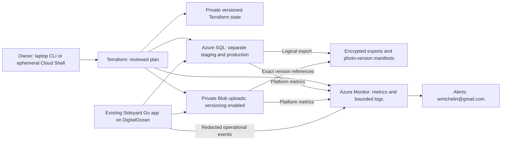

# Sideyard Azure execution plan

## Status update

Status: implementing — user authorized Azure SQL, versioned Blob and seven-day backups.
Last completed: both environments provisioned; staging Blob application verified; both Azure exports restored, including staging photo recovery bytes.
Now: explicit PostgreSQL-to-SQL Server application port, September 9, 2026.
Next: verify both database backends and idle behavior before a reviewed database cutover.
Evidence: Blob staging release `7181040`; exact artifacts in the delivery status.
Staging: https://clubdue-staging.michelindigitalmedia.com (verified for Azure Blob; application database remains PostgreSQL).
Blocker: no sign-in blocker. The live free SQL API requires a 60-minute idle delay; the plan below reflects that correction.

The user accepted Blob Storage's 12-month free offer, the 0.5–1 vCore database
configuration and seven-day backups, and requested implementation. The initial
plan was reviewed locally; the implementation has additional architect/staff,
DevOps/testing and product/QA agent reviews recorded in the delivery status.

[PRODUCT-MAP.md](PRODUCT-MAP.md) remains the source of truth for implemented
features and client onboarding. This plan includes unfinished work; it is not a release
availability claim. Deployment evidence belongs in
[SIDEYARD-DELIVERY-STATUS.md](SIDEYARD-DELIVERY-STATUS.md).

## Delivery brief

**Outcome:** keep Sideyard's database and private uploads in managed Azure
services, use their free allowances at the current scale, recover data from
backups, receive operational alerts, and manage everything through versioned
Terraform and CLI commands while traveling.

**Priority:** P1 infrastructure. Preserve customer records, authentication,
tenant isolation, photo limits, signup emails, existing workflows and all
Sideyard/ClubDue hostnames. The Go app stays on the current DigitalOcean host.
Its existing hosting bill continues; this plan estimates incremental Azure cost.
Pantry and Headscale are outside the change.

**Accepted configuration:** pause Azure SQL at the monthly free compute limit.
The user accepted this plan after the awake-hour limits were explained; paid
database overages remain disabled. Blob Storage and monitoring need usage controls and alerts because
their free allowances are not hard spending caps.

## Chosen services and cost boundaries

| Service | Proposed configuration | Included allowance and boundary |
| --- | --- | --- |
| Database | One Azure SQL General Purpose serverless free-offer database per environment | Per database: 100,000 vCore-seconds/month, 32 GB data and 32 GB backups, ongoing. Use two of the subscription's maximum ten free databases. |
| Uploads | Standard StorageV2, Hot block blobs, locally redundant storage (LRS); private containers and versioning | Eligible new-account offer: 5 GB, 20,000 reads and 10,000 writes/month for the first 12 months. These are shared allowances, not a new grant for every storage account. |
| Native database backups | Local redundancy and the free offer's seven-day retention | Point-in-time recovery within its supported window; destination database costs must be checked before a restore. |
| Independent recovery copy | Daily encrypted logical database exports plus an exact photo-version manifest; retain seven days | Exports and retained photo versions consume Blob capacity and operations. Exporting also consumes SQL compute. |
| Monitoring | Azure Monitor platform metrics, bounded Analytics Logs and email action group | Budget against the subscription/billing-account allowances described below. |
| Infrastructure state | Small, separate versioned Blob backend using Entra authentication | State and its versions consume the same storage offer; no separate free quota. |

Azure SQL's recurring free offer is a SQL Server service. The application
currently uses PostgreSQL; this requires a database-engine port, not changing a
connection string. The free offer's restrictions also rule out treating a native
restore or database copy as a free migration shortcut.
[SQL offer](https://learn.microsoft.com/en-us/azure/azure-sql/database/free-offer?view=azuresql)
· [SQL offer FAQ](https://learn.microsoft.com/en-us/azure/azure-sql/database/free-offer-faq?view=azuresql).

The Blob offer starts with the eligible Azure account, not the date we create
Sideyard's storage. Record its actual expiry. Continuing after the introductory
trial requires the applicable pay-as-you-go account setup; usage outside the
included amounts can be billed even during year one.
[Azure free services](https://azure.microsoft.com/en-us/pricing/free-services/).

### Blob Storage after the free year

**Implementation region update:** account capability checks permit the requested
SQL size in Central US and restrict it in East US/East US 2. Application SQL and
Blob resources will use Central US; its verified Hot LRS rate is $0.0184/GB-month
($0.92 for 50 GB), with the same operation rates below. The tiny, separately
bootstrapped Terraform state account stays in East US at $0.0208/GB-month.
The original comparison below is retained as an explicitly East US estimate.

USD retail rates checked September 9, 2026 for **East US, General Block Blob v2,
Hot LRS**. Recheck the selected region and account price before provisioning.

| Meter | Rate |
| --- | --- |
| Stored data, first pricing tier | $0.0208 per GB-month |
| Write operations | $0.05 per 10,000 |
| Read operations | $0.004 per 10,000 |
| List/create-container operations | $0.05 per 10,000 |

| Total billable storage, including retained versions and exports | Storage cost/month |
| --- | --- |
| 5 GB | $0.10 |
| 25 GB | $0.52 |
| 50 GB | $1.04 |
| 100 GB | $2.08 |

For example, **50 GB + 10,000 writes + 100,000 reads = about $1.13/month**,
before bandwidth, other operations and tax. An upload can involve multiple
operations. These are usage examples, not a cap or a forecast of customer growth.
Rates were retrieved from the
[Microsoft Retail Prices API](https://prices.azure.com/api/retail/prices?%24filter=serviceName%20eq%20%27Storage%27%20and%20armRegionName%20eq%20%27eastus%27%20and%20priceType%20eq%20%27Consumption%27%20and%20productName%20eq%20%27General%20Block%20Blob%20v2%27&currencyCode=USD)
and correspond to the [Blob pricing categories](https://azure.microsoft.com/en-us/pricing/details/storage/blobs/).

Standard internet outbound transfer includes the first 100 GB/month; the next
tier from North America through Microsoft's network is $0.087/GB. The allowance
must be checked against other account usage. Reading Azure photos through the
DigitalOcean app is outbound traffic from Azure. At 200 GB outbound, the extra
100 GB would add approximately $8.70. Inbound transfer is free.
[Bandwidth pricing](https://azure.microsoft.com/en-us/pricing/details/bandwidth/).

Use the Hot tier throughout this initial setup. Versions contribute to billable
storage; Azure's unchanged blocks can be shared for billing, so do not assume
every version always consumes another full copy. Do not change tiers just to
save pennies without accounting for retrieval and retention charges.
[Version billing](https://learn.microsoft.com/en-us/azure/storage/blobs/versioning-overview#pricing-and-billing).

### When the database pauses

There are two different conditions:

1. **Idle:** no open sessions or active work for the configured delay. Use
   **60 minutes**: the September 9 live create API rejected 15 minutes with
   `ProvisioningDisabled`, requiring the free offer's default delay. General
   serverless capabilities advertising 15 minutes do not apply to this offer.
   A subsequent connection resumes compute;
   Sideyard must handle the cold start with bounded retries and useful feedback.
2. **Free compute exhausted:** with `freeLimitExhaustionBehavior = "AutoPause"`,
   the database stays unavailable until the next calendar month's allowance.
   This can happen despite a tiny database. Free-offer storage constraints are
   separate; plan no automatic expansion beyond 32 GB.

Azure supports a 0.5-vCore minimum; its smallest published General Purpose
serverless range is **0.5–1 vCore** (`GP_S_Gen5_1`). A fixed 0.5-vCore maximum
is not listed. Use this smallest range as the proposed starting point, subject
to free-offer availability and performance verification in the target account.
[Serverless resource limits](https://learn.microsoft.com/en-us/azure/azure-sql/database/resource-limits-vcore-single-databases?view=azuresql#general-purpose---serverless-compute---standard-series-gen5).

The earlier 55.6-hour calculation assumed exactly 0.5 billed vCore. Microsoft's
current resource table lists a 2.02 GB minimum memory allocation for the smallest
range, and billing uses the larger of CPU or memory normalized at 3 GB/vCore.
That makes the documented minimum about 0.673 billed vCore, implying **roughly
41.3 awake hours/month** from 100,000 vCore-seconds, before greater resource use.
This is a calculation from published limits, not a measured Sideyard result.
Idle tails, backups and maintenance consume part of this allowance. Paused
compute consumes none; keeping a connection open all month does not fit this
free operating budget. Verify actual consumption in staging.
[Billing formula](https://learn.microsoft.com/en-us/azure/azure-sql/database/serverless-tier-billing?view=azuresql).

The alternative `BillOverUsage` keeps the database running with charges after
the allowance. Microsoft's current free-offer instructions say switching to
continued paid usage cannot be switched back to the monthly quota-pause choice.
Treat that as a separate, informed decision.
[Free-limit behavior](https://learn.microsoft.com/en-us/azure/azure-sql/database/free-offer?view=azuresql).

## Target layout



The backup node represents a separate protected container in each environment's
Blob account. Use separate storage accounts and SQL logical servers for staging
and production, plus one small state account. Free allowances are still shared
where specified above. Keep all resources in the same supported region, with
Central US selected after account capability checks; Terraform state remains in
East US. No app hosting migration is required.

## Implementation slices and completion gates

### A0 — Verify the offer and establish the budget

- Read account/subscription eligibility, original free-account start date,
  existing free-service consumption, SQL free-database count and supported
  region through CLI/API. Do not claim eligibility from an advertising page.
- Record the actual Blob expiry, applicable rates, shared monitoring usage and
  the projected first-year/after-year-one bill. Show any difference from this
  estimate before creating chargeable resources.
- Allocate the 5 GB between production photos, staging, exports, retained
  versions and Terraform state. Start with a 4 GB aggregate warning, preserving
  headroom. Upload admission must include pending bytes, not only committed rows.
- Plan cost alerts at $1 and $5/month, plus notices 60, 30 and 7 days before the
  storage benefit ends. These thresholds notify; they do not authorize a budget
  or automatically stop Azure charges. Derive dates from actual eligibility.

**Pass:** a recorded, account-specific estimate, free-offer eligibility and exact
expiry; the database quota-pause proposal remains explicit.

### A1 — Terraform and CLI operation

- Add `infra/azure/bootstrap`, `infra/azure/shared` and
  `infra/azure/environments/{staging,production}` when implementing. Pin tested
  Terraform/provider versions and commit the dependency lock file.
- Bootstrap a private Blob state backend through an idempotent CLI script.
  Use separate state keys and access scopes, Entra authentication and state
  locking. Protect the backend from routine application teardown.
  [AzureRM backend](https://developer.hashicorp.com/terraform/language/backend/azurerm).
- Use AzureRM for the normal Azure resources. Create each SQL database through
  **one AzAPI resource** with the free-offer properties present on its first
  request; the reviewed native AzureRM database resource lacks those fields.
  Do not create a paid database and patch it afterward, or let two Terraform
  resources own the same database.
- Use stable `Microsoft.Sql/servers/databases@2025-01-01` with
  `useFreeLimit = true`, `freeLimitExhaustionBehavior = "AutoPause"`, local
  backup redundancy, 32 GB maximum and a validated serverless SKU. Propose
  minimum 0.5 vCore, maximum 1 and a 60-minute idle delay; validate availability
  and read back every setting before accepting the first test database.
  [API schema](https://learn.microsoft.com/en-us/azure/templates/microsoft.sql/2025-01-01/servers/databases)
  · [AzureRM database schema](https://github.com/hashicorp/terraform-provider-azurerm/blob/main/website/docs/r/mssql_database.html.markdown).
- Private Blob containers, public blob access disabled, HTTPS/TLS 1.2 or newer,
  hierarchical namespace disabled and versioning enabled. Add resource deletion
  locks and container soft-delete protection; include retention in the storage
  budget and deletion documentation. LRS protects against local hardware loss;
  it is not a cross-region disaster-recovery copy.
- Firewall SQL/Blob data access to the app and narrowly scoped operator access;
  keep a CLI path for adding/removing a temporary operator IP. Use TLS with
  certificate verification. No broad "allow all Azure services" SQL exception.
- Use GitHub OIDC for infrastructure automation with protected environment
  permissions. The off-Azure app uses a dedicated Entra application credential
  stored outside Git; separate runtime, migration and backup permissions.
  It cannot assume an Azure VM managed identity. Document CLI credential rotation.
  Account for runner networking: add narrowly scoped, temporary runner IP rules
  for state/data access and remove them on exit, with cleanup for interrupted jobs.

**Pass:** a fresh checkout can initialize, validate, plan and apply the reviewed
staging resource plan; a second plan is empty. Verify actual free flags,
versioning, denied anonymous access and environment isolation. No automatic
production infrastructure apply on push.

### A2 — Port PostgreSQL behavior and make idle time work

Relevant current boundaries include [connection/migrations](../internal/postgres/db.go),
[app startup](../internal/app/main.go), [maintenance](../internal/app/runtime.go),
[notification worker](../internal/app/interest_notifications.go) and
[readiness](../internal/app/handlers.go).

- Add an explicit SQL Server backend using `database/sql` and the Microsoft Go
  driver. Inject repositories and transaction boundaries where domain code
  consumes them. Keep PostgreSQL working during migration; avoid a generic SQL
  rewriting framework or unrelated domain refactors.
- Add a separate checksummed T-SQL migration history. Preserve the existing 30
  PostgreSQL migration files/checksums. Port parameter syntax, upserts, returned
  rows, JSON, dates, UUIDs, locks and uniqueness deliberately. Handle SQL Server's
  multiple-cascade-path restrictions with explicit, atomic deletion ordering.
- Prove tenant-scoped foreign keys, exact cents/measurements, UTC instants,
  date-only schedules, collation-sensitive identities, immutable histories,
  duplicate submissions and concurrent quota enforcement with real SQL Server.
- Close idle database sessions. Replace the existing 15-second outbox polling
  with a post-commit wake signal and durable queue drain, startup recovery and
  bounded retry for known pending work. Keep idempotency and crash recovery;
  do not make email delivery depend only on an in-memory signal.
- Batch daily maintenance, reconciliation and logical backups into one active
  period. Make deployment migrations an explicit step. A restart during a SQL
  outage must still serve static/public pages without claiming database readiness.
- External process checks use `/livez`, not the database-pinging `/readyz`.
  Use database readiness during deployment and deliberate diagnostics. Database
  operations must preserve form input and show temporary unavailability on
  failure; never confirm that an interest signup or payment was saved when it was not.

**Pass:** both backends satisfy the relevant behavioral suite; signup alerts
recover from send failure/restart without uncontrolled duplicates. Azure actually
pauses and resumes during an idle rehearsal. Record cold-start experience and
the `app_cpu_billed`/free-amount metrics, not an estimate based on database size.

### A3 — Private Blob uploads and recoverable backups

The [current photo implementation](../internal/app/property_photos.go) keeps
bytes in PostgreSQL with image normalization, tenant authorization, transaction
quotas and deletion tombstones. Preserve those contracts while moving bytes.

- Add an injected Blob client and an explicit upload state: reserve the shop's
  quota, write a unique object, save its key/version/hash and finalize the record.
  Reconcile interrupted uploads and orphaned objects with bounded retries.
  SQL and Blob cannot share a transaction; avoid exposing half-finished uploads.
- Keep metadata/captions in SQL. Authorize each image request through Sideyard
  before streaming private bytes; no public bucket or long-lived sharing URL.
  Preserve current input/normalized limits and owner-only access. Track versions
  separately from each shop's active-photo quota for the Azure cost budget.
- Enable versioning before copying existing images. Verify source/destination
  hashes, tenant ownership and row counts. Use immutable object keys; preserve
  the exact version ID in recovery manifests. Do not remove the old database
  bytes until reconciliation and a restore rehearsal pass.
- Hide deleted photos immediately and preserve tombstone/idempotency behavior.
  Retain recoverable versions for the accepted seven-day window. Garbage collection
  must respect retirement time and every retained backup manifest. **Do not apply
  a blanket "delete versions older than seven days" rule to photo versions:**
  creation time can be months before deletion, while a recent backup still needs
  that version. Coordinate cleanup with any running restore.
- Keep native seven-day backups and add a daily, authenticated encrypted logical
  export with schema version, row counts, checksums and exact asset manifest.
  Use a consistent SQL snapshot; retain seven days. Separate the export writer
  from destructive retention privileges, and keep recovery keys outside the
  application host with documented access from the road.
- Put exports in the protected backup container; native Azure SQL backup storage
  is a different meter. Inventory data, versions, soft-deleted content and exports
  together. Use lifecycle rules only where their time semantics are safe.
  [Lifecycle management](https://learn.microsoft.com/en-us/azure/storage/blobs/lifecycle-management-overview).

**Pass:** unauthorized access fails; retries neither lose photos nor inflate
quotas. Restore both the newest and oldest retained backup to an isolated target,
including an old photo deleted recently. Verify exact bytes and tenant isolation.
Target a daily-export recovery point within 24 hours; measure restore time before
promising an RTO. Native PITR restores may create a billed destination; check its
cost first. A logical import into an unused eligible free database is a separate
restore path whose compute also counts. Versioning alone does not protect against
loss of the whole storage account.

### A4 — Monitoring and alerts

- Send operational email alerts to **wmichelin@gmail.com** using Azure Monitor
  action groups. Include environment, condition and a CLI/runbook link. Send
  recovery notifications and suppress repeated identical incident messages.
- Budget at most ten monitored metric time series across the subscription:
  each environment gets two remaining-compute thresholds (30,000 and 10,000
  vCore-seconds), one database storage threshold, one failed-connection threshold
  and one Blob capacity threshold. Existing subscription rules reduce the
  available allocation; split Blob capacity thresholds to respect the shared
  5 GB allowance. Do not add dimensions that silently multiply billed series.
- Use the platform `free_amount_remaining` gauge at its supported 15-minute
  granularity; do not sum a remaining-balance gauge. Add free Activity Log,
  Service Health and Resource Health alerts, plus expiry/budget notices.
  [SQL metric definitions](https://learn.microsoft.com/en-us/azure/azure-monitor/reference/supported-metrics/microsoft-sql-servers-databases-metrics).
- Use one Log Analytics workspace with environment tags, 31-day retention and
  a target below 1 GB/month. Collect sampled errors, backup outcomes and worker
  failures; exclude credentials, tokens, photo contents and customer form bodies.
  The first 5 GB/month of Analytics Logs is shared per billing account. Validate
  the minimum supported daily cap and set it conservatively; ingestion caps can
  lag, so source filtering is the first control.
  [Daily-cap behavior](https://learn.microsoft.com/en-us/azure/azure-monitor/logs/daily-cap).
- Provision a custom Analytics table and data collection rule in Terraform.
  Add a bounded asynchronous exporter from the DigitalOcean app through the
  Logs Ingestion API, with a narrowly scoped Entra identity. Keep local logs if
  export fails; exporting must not query SQL or block customer requests.
  [Logs Ingestion API](https://learn.microsoft.com/en-us/azure/azure-monitor/logs/logs-ingestion-api-overview).
- The included platform allowance is ten monitored metric time series and
  1,000 email notifications/month. Platform metrics and ordinary activity/health
  alerts supply the baseline; avoid paid dynamic thresholds, SMS and calls.
  Log-query alert rules are not assumed free. Send bounded backup/worker failure
  notifications through the existing mail integration and check its own allowance.
  [Azure Monitor pricing](https://azure.microsoft.com/en-us/pricing/details/monitor/).
- For external reachability, propose one hourly GitHub Actions check covering
  both public landing pages and `/livez`, with failure notifications enabled.
  Use scoped OIDC access to check the last successful backup manifest's timestamp
  too, without querying SQL; alert if no verified export exists within 26 hours.
  First verify spare included Linux minutes: this private repository shares its
  allowance with CI, and hourly runs can use about 744 minutes/month if each job
  stays within a minute. Scheduled runs can be delayed; this is a coarse check.
  Do not enable it if account usage would make it paid without revising the estimate.
  [Actions billing](https://docs.github.com/en/billing/concepts/product-billing/github-actions)
  · [Schedule behavior](https://docs.github.com/en/actions/reference/workflows-and-actions/events-that-trigger-workflows#schedule).
- Do not build on the old free Azure URL-ping tests that retire September 30,
  2026. Standard availability tests are metered. Frequent end-to-end database
  probes would also defeat idle savings.
  [Availability tests](https://learn.microsoft.com/en-us/azure/azure-monitor/app/availability).

**Pass:** exercise a real alert and recovery email, a failed backup notification
and a missed-notification retry. Stop the backup worker in rehearsal and prove
the independent freshness check catches it. If the runner-minute allowance does
not cover this check, resolve the monitoring budget before production; a manual
CLI freshness check is not equivalent to an automatic alert. Document that the
hourly web probe checks reachability, not every customer transaction.

### A5 — Migration rehearsal and staging

- Build a resumable logical migration CLI that preserves IDs, auth hashes,
  relationships, histories, exact amounts, tombstones and notification state.
  A PostgreSQL dump is not a SQL Server import. Keep checkpoints and bounded
  batches; compare per-table/per-shop row counts and meaningful checksums.
- Rehearse against an isolated snapshot and environment. Suppress customer mail
  and production integrations during import/recovery. Verify notification
  pending/sent state before enabling workers.
- Freeze the app revision and schema included in each cutover. Current recorded
  production is `ae6f16a` through migration 029; staging is `53b7878` with jobs
  and migration 030. Refresh those facts at execution time. A migration must not
  silently promote the separate staging-only job feature.
- Deploy the reviewed Azure backend to staging, run the repository CI/build,
  isolated restore/pilot rehearsals and `./scripts/smoke-test.sh staging`.
  Exercise sign-in, interest/email, imports, recurring/seasonal work, notes,
  photos and the release-appropriate job flows on phone and desktop.
- Soak for seven days with realistic pilot traffic, maintenance, exports and
  idle periods. Project the observed monthly compute usage, including idle
  tails; target less than 70% of the allowance for each database. Simulate quota
  exhaustion through a controlled failure seam rather than burning credits.

**Pass:** migration reconciliation is exact, recovery succeeds, feature
regressions are resolved and measured usage has headroom. Present staging URL,
immutable app artifact, infrastructure plan, timing and cost evidence for review.

### A6 — Production cutover and recovery

- Follow [RELEASE-WORKFLOW.md](RELEASE-WORKFLOW.md): reviewed staging evidence,
  explicit chat approval, then the production workflow. A plan approval is not
  an approval to cut over an unreviewed production build.
- In the agreed maintenance window, stop writes/workers, take and verify final
  encrypted exports, migrate the final consistent state and reconcile SQL/Blob.
  Deploy the approved artifact and configuration; validate before reopening
  writes and notification delivery. Record the actual interruption duration.
- Preserve the original PostgreSQL data and encrypted backups for the recovery
  window. Before Azure accepts new writes, the old application/database remains
  the simple recovery path. **After new Azure writes, switching back to old
  PostgreSQL would lose data.** Freeze writes and reconcile a reverse export, or
  fix forward; exercise that decision path during rehearsal.
- Check actual costs and quota use the next day and after the first week. Update
  product-map storage, limits, deletion/recovery and availability descriptions
  only after verified release, with evidence in the delivery status document.
- Retire the old active database only after the retention window and a successful
  independent restore. Refresh the estimate 60 days before the Blob benefit ends.

**Pass:** both Sideyard and legacy hostnames work on the approved production
artifact, data and photos reconcile, signup/operational notifications work,
backups are recoverable and billing matches the configured offer.

## Operating from the road

The implementation will provide documented wrappers under `scripts/azure/` for
bootstrap, plan/apply, status/quota, backup, isolated restore and credential
rotation. The following illustrates the intended workflow; these paths/scripts
do not exist yet:

```sh
az login --use-device-code
az account set --subscription '<verified-subscription-id>'
git pull --ff-only
terraform -chdir=infra/azure/environments/staging init
terraform -chdir=infra/azure/environments/staging fmt -check
terraform -chdir=infra/azure/environments/staging validate
terraform -chdir=infra/azure/environments/staging plan -out=reviewed.tfplan
# Review the resource changes and cost/offer checks before the next command.
terraform -chdir=infra/azure/environments/staging apply reviewed.tfplan
```

Authentication can require device/browser approval, but routine provisioning,
configuration, monitoring and recovery will use CLI/API. An ephemeral Cloud
Shell session is a fallback without a persistent Azure Files share: clone the
repo, authenticate and initialize the remote state. State and recovery keys must
survive losing the laptop or Cloud Shell session. Saved plans can contain
sensitive data; keep them out of Git and delete them after use.
[Ephemeral Cloud Shell](https://learn.microsoft.com/en-us/azure/cloud-shell/get-started/ephemeral).

## Team review

| Perspective | Concrete recommendation and acceptance evidence |
| --- | --- |
| Product manager | Preserve the canonical product map's current workflows and signup alerts. Explain cold starts, quota outages and storage expiry. Existing app hosting and future trade features remain separate scope. |
| Architect | Treat PostgreSQL → SQL Server as a port with explicit repository/transaction boundaries. Enforce tenant relationships in both engines; handle the non-atomic SQL/Blob upload and exact-version recovery. |
| Unit-testing expert | Inject SQL repositories, object client, mail sender and clock. Test concurrent quotas, interrupted uploads, deleted-photo replay, cold-start retries, quota failures and outbox crash recovery; verify SQL semantics with a real engine. |
| Staff software engineer | Keep migrations separate and checksummed; avoid automatic query translation. Implement one backend/domain slice at a time, keeping PostgreSQL behavior tested through the recovery window. |
| DevOps engineer | Own the free flags in Terraform from creation, verify live settings, isolate state/identities, and prove CLI recovery. Measure sleep and shared metered usage before production; retain staging/review gates. |
| QA tester | Rehearse tenant isolation, actual Azure pause/resume, each critical page, email delivery, oldest-backup/photo recovery and cutover after new writes. Record artifact IDs, screenshots where useful, timings and costs. |

**Decision:** implementation authorized for 0.5–1 vCore with free-limit pause,
versioned Hot LRS Blob storage and seven-day recovery. Confirm actual offer
eligibility/expiry before provisioning. Seven-day recoverability does not imply
exact physical erasure at 168 hours: version garbage collection and soft-delete
windows can retain billable bytes longer. Preserve existing historical backups
until their established retention expires. Production app migration retains the
reviewed-staging release gate; paid database overages are not authorized.
